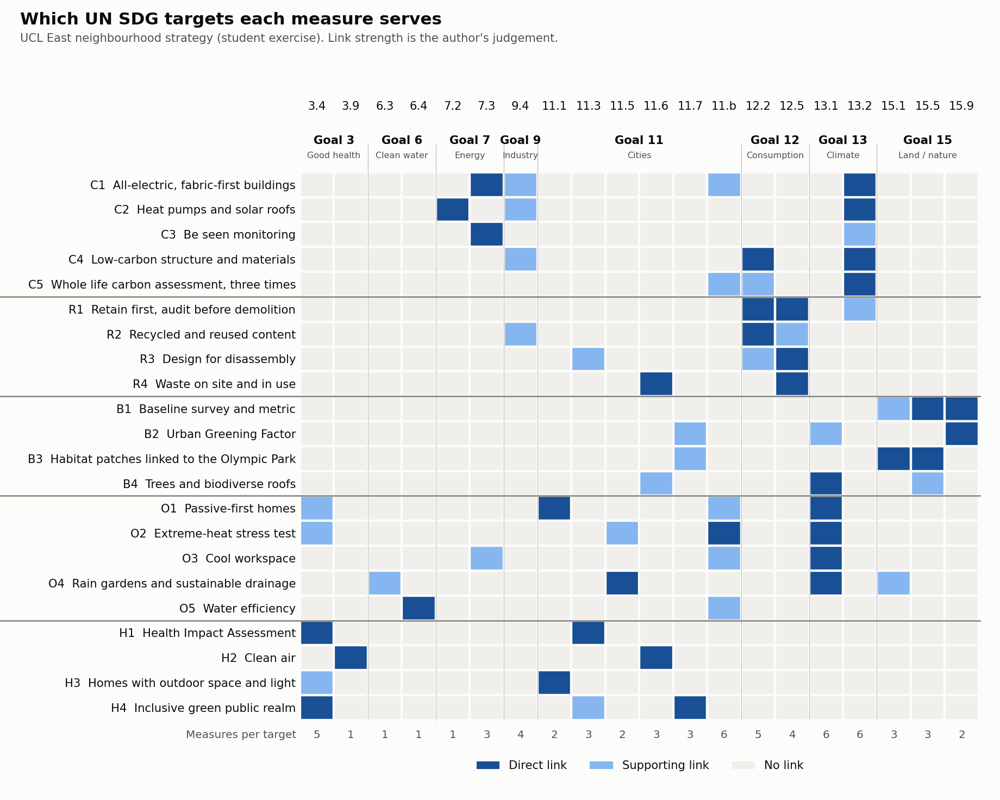
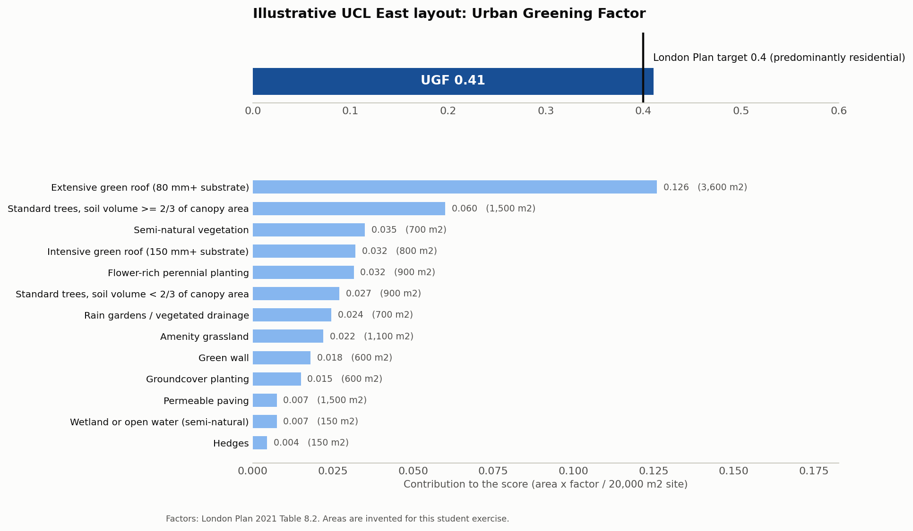

**This is a student exercise, not a real commission.** The site, brief and targets are my own invention, and I am not affiliated with Arup or any other consultancy. The writing style imitates a masterplan sustainability strategy; the policy figures are real and cited.

# UCL East neighbourhood: sustainability strategy

## The brief

A self-set brief: a mixed-use neighbourhood of about 300 homes and about 6,000 m² of workspace on a 2.0 ha site near UCL East, Queen Elizabeth Olympic Park, Stratford, London. The task is to show how it could meet current English and London rules on carbon, circular economy, nature, overheating and health, with every measure tied to a specific United Nations Sustainable Development Goal (SDG) target.

## Summary

The strategy has 22 measures across five themes: carbon (operational and embodied), circular economy, biodiversity and greening, overheating and climate resilience, and health and wellbeing. Each one states the policy it answers to (London Plan 2021, Greater London Authority (GLA) guidance, Building Regulations Part O, the Environment Act 2021), a measurable target, and the SDG targets it serves. Examples: all-electric homes using at most 35 kWh/m² a year; embodied carbon at the GLA's aspirational 500 kgCO₂e/m²; at least 10% biodiversity net gain; every home passing the national overheating test (CIBSE TM59). A small calculator tests whether an illustrative landscape layout reaches the London Plan's Urban Greening Factor target. Where I could not verify something, [strategy.md](strategy.md) says so.

## SDG heatmap



Dark cells are direct links, light cells supporting links. The link strengths are my judgement. The full table is [sdg_matrix.csv](sdg_matrix.csv). Climate (13.1, 13.2) and natural resources (12.2) are the most-served targets. Four targets (3.9 air and pollution, 6.3 water quality, 6.4 water efficiency, 7.2 renewable energy) each rest on a single measure.

## Urban Greening Factor result

The Urban Greening Factor (UGF) is a score from the London Plan for how much useful greenery a site has. Each surface type gets a factor from 0 (sealed paving) to 1 (semi-natural vegetation). The score is the area-weighted total divided by site area.



**Score: 0.41 (8,210 ÷ 20,000 = 0.4105) against a target of 0.4**, so the layout meets it with a margin of about 0.01. Homes are the largest use (27,000 m² versus 6,000 m²), so the residential target applies [GLA UGF guidance, paras 1.1.2 and 3.2.2].

| Surface cover | Area (m²) | Factor |
|---|---|---|
| Extensive green roof, 80 mm+ substrate | 3,600 | 0.7 |
| Intensive green roof | 800 | 0.8 |
| Semi-natural vegetation | 700 | 1.0 |
| Wetland or open water (semi-natural) | 150 | 1.0 |
| Flower-rich perennial planting | 900 | 0.7 |
| Rain gardens | 700 | 0.7 |
| Groundcover planting | 600 | 0.5 |
| Hedges | 150 | 0.6 |
| Amenity grassland | 1,100 | 0.4 |
| Permeable paving | 1,500 | 0.1 |
| Sealed surfaces (roofs and ground) | 9,800 | 0.0 |
| **Plan areas (equal the site)** | **20,000** | |
| Extra layer: 50 trees, soil volume ≥ ⅔ of canopy (30 m² canopy each) | 1,500 | 0.8 |
| Extra layer: 30 trees, smaller pits | 900 | 0.6 |
| Extra layer: green wall (vertical area) | 600 | 0.6 |

Factors come from London Plan 2021 Table 8.2 (listed in full in [docs/sources.md](docs/sources.md)). Following the GLA method, tree canopy and green walls are scored in addition to the plan areas.

**Read this with care.** I invented the layout and chose it to match the strategy's own targets, so passing is partly by design. It is a test of the arithmetic, not evidence that a real scheme would pass. The margin is thin: without the green wall the score falls to 0.39, below target. The 30 m² canopy per tree is an assumption.

## How to run

You need Python 3 with `pandas` and `matplotlib`, and nothing else. From this folder:

```bash
python3 make_heatmap.py
```

```bash
python3 ugf_calculator.py
```

The first reads `sdg_matrix.csv` and writes `images/sdg_heatmap.png`. The second prints the score table and verdict and writes `images/ugf_result.png`. To test a different layout, edit `PLAN_LAYOUT` and `EXTRA_LAYOUT` in `ugf_calculator.py`; the plan areas must add up to the site area or the script stops with an error.

## Files

| File | What it is |
|---|---|
| [strategy.md](strategy.md) | The strategy, about 1,900 words |
| [sdg_matrix.csv](sdg_matrix.csv) | Every measure mapped to its SDG targets |
| [make_heatmap.py](make_heatmap.py) | Turns the matrix into the heatmap |
| [ugf_calculator.py](ugf_calculator.py) | Urban Greening Factor calculator |
| [docs/sources.md](docs/sources.md) | Every source URL, every policy figure, and how well I could verify each |

## Sources

Full list with URLs, a register of every figure, and a list of what I could not verify: [docs/sources.md](docs/sources.md). The main ones:

- [London Plan 2021, chapter 8 (Policy G5, Table 8.2)](https://www.london.gov.uk/programmes-strategies/planning/london-plan/the-london-plan-2021-online/chapter-8-green-infrastructure) and [chapter 9 (Policies SI 2, SI 4, SI 7)](https://www.london.gov.uk/programmes-strategies/planning/london-plan/the-london-plan-2021-online/chapter-9-sustainable-infrastructure)
- [GLA, Urban Greening Factor guidance, January 2023](https://www.london.gov.uk/media/99842/download)
- [GLA, Whole Life-Cycle Carbon Assessments guidance, March 2022](https://www.london.gov.uk/sites/default/files/lpg_-_wlca_guidance.pdf)
- [GLA, Circular Economy Statements guidance, March 2022](https://www.london.gov.uk/sites/default/files/circular_economy_statements_lpg_0.pdf)
- [GLA, Energy Assessment Guidance, June 2022](https://www.london.gov.uk/sites/default/files/gla_energy_assessment_guidance_june_2022_0.pdf)
- [Approved Document O: Overheating](https://assets.publishing.service.gov.uk/media/6218c5aad3bf7f4f0b29b624/ADO.pdf) and [CIBSE TM59 (2026) page](https://www.cibse.org/knowledge-research/knowledge-portal/tm59-overheating-risk-in-dwellings-a-design-stage-methodology-2026/)
- [GOV.UK, Understanding biodiversity net gain](https://www.gov.uk/guidance/understanding-biodiversity-net-gain) and [Environment Act 2021, Schedule 14](https://www.legislation.gov.uk/ukpga/2021/30/schedule/14)
- [UN Sustainable Development Goals](https://sdgs.un.org/goals)
